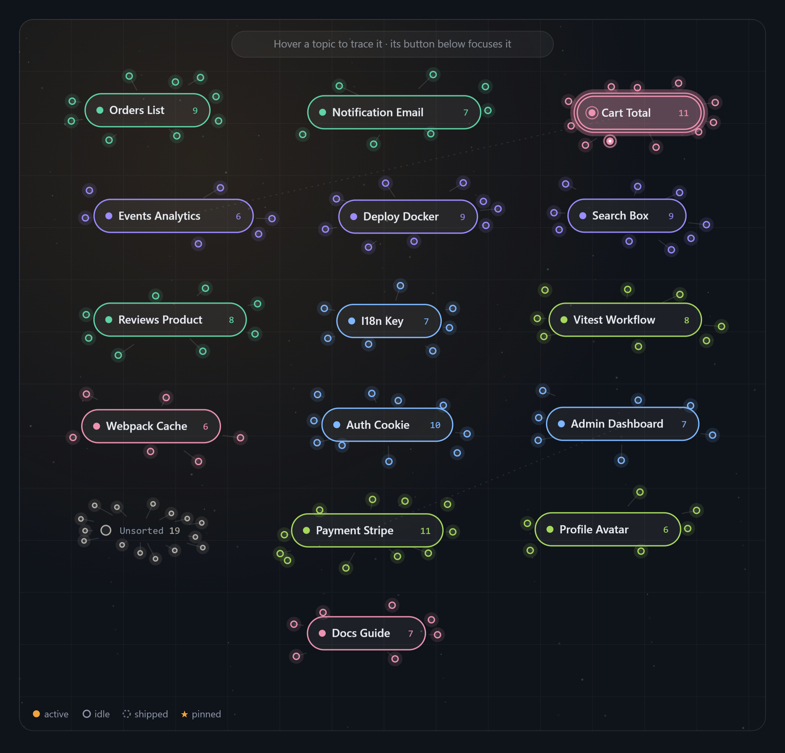
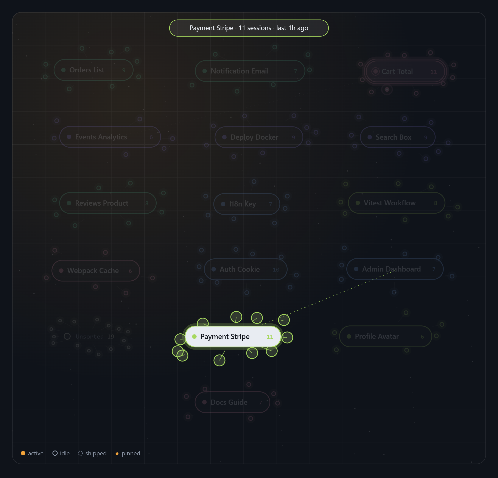
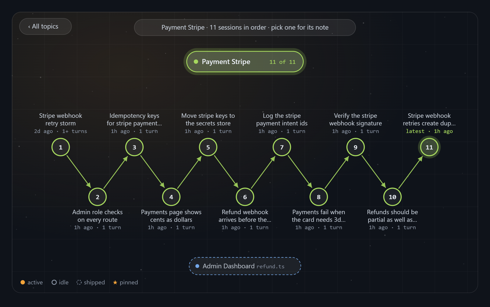
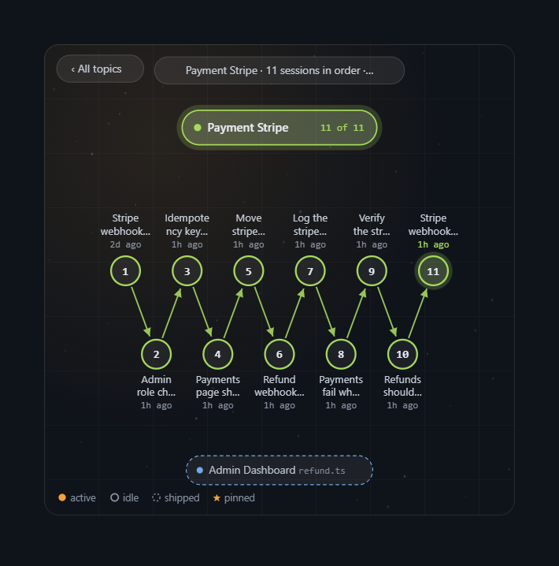
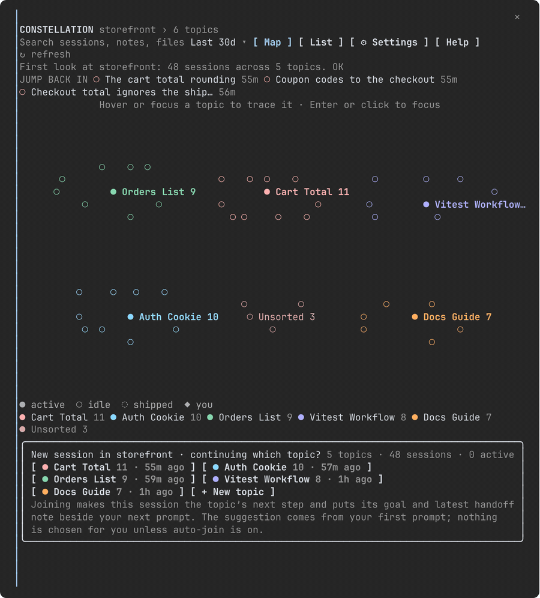
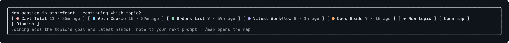
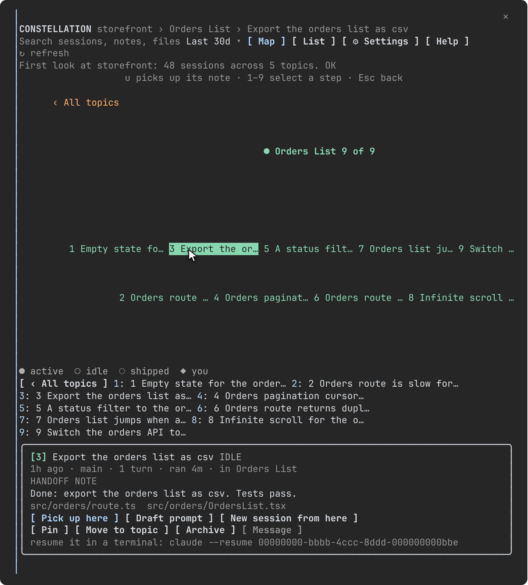

# Constellation

A Claude Code mod that maps the sessions of one project folder as a
constellation of topics. One folder holds many topics; each topic is an ordered
chain of sessions; every new session joins a chain and picks up that chain's
goal and latest handoff note, so same-topic sessions stop piling up in the
Desktop sidebar and nothing is lost between them.

- **A map of your work.** Every session Claude Code has run in the folder,
  read from its transcripts, clustered into topics by what they touched and
  talked about, drawn as a field of labelled pills with their sessions in orbit.
- **Chains, not piles.** Focus a topic and its sessions line up as numbered
  steps in time order, the latest glowing, with this session as the next step.
- **Handoffs that travel.** Each session leaves a short note (written by haiku
  after each turn, or by you with `/park`). Joining a topic puts the topic's
  goal and the latest note beside your next prompt, for Claude's eyes only.
- **Token-lean.** Everything but the notes is local text matching. The
  zero-token path is one setting away, and the settings view counts what the
  model was asked.



Status: built against Claude Code 2.1.310, run end to end on 2.1.311 and
re-run on Windows 11 with 2.1.308, every picture on this page drawn by the
real engine. `claude plugin validate --strict`, `claude plugin test` (260
tests, including an edge-case suite), `tsc` and four end-to-end suites pass:

- `tests/e2e/tui.sh` drives the real Claude Code TUI in tmux with real mouse
  events: hover, clicks on topics, steps, dots and buttons, a drag, the
  keyboard after a click and after Escape, the band, every command, a real
  model turn that quotes the injected handoff note, `/clear`, and the classic
  renderer that has no mouse (67 checks, run as installed through the
  one-line installer by `E2E_INSTALL=1`).
- `tests/e2e/desktop.mjs` runs the engine the way Claude Desktop does, over
  its stdio wire, and acts as the Desktop's frame: it loads the map's Client
  with the runtime the engine serves, sizes it as the Desktop does (as wide as
  the picture, as tall as what it draws, in the Desktop's 7.7 × 19.8 px cells)
  and clicks every node of the picture through it at five layer widths, in a
  44-column pane, with a wider font before and after Layer height +2, over
  the fixture folder, a 140-session folder with a transcript over 4 MiB, an
  empty folder, and new sessions opening the map on Desktop, VS Code and
  mobile; it checks that the layer matches the picture node for node, and
  that the live picture arrives in its frame with a hover rule per topic, no
  script, the running topic's ring and ripple, and under the size cap (267
  checks).
- `tests/e2e/frame.mjs` puts the live pictures through the Desktop's own
  frame in Chromium: its scrub (DOMPurify as the Desktop calls it), its
  sandboxed frame sized by the Svg's width and height, and a real pointer;
  it checks the frame is the picture's size, the scrub keeps it whole, hover
  traces a topic and swaps the caption, and the idle cycle eases the rest to
  about 0.4 topic after topic (24 checks).
- `tests/e2e/installers.sh` runs `install.sh` under sh, dash and bash against
  stand-in `claude` commands laid out as on macOS, Linux and Windows (78
  checks); `tests/e2e/installers.ps1` runs the same cases against
  `install.ps1` on Windows (56 checks).

The previous build was run on Windows 10 with Claude Desktop 3.6556; this one
fixes what that run found (a pointer layer that covered only the picture's
top, colliding topic names, anchors off the field, a reclaimed keyboard
reopening a closed pane, the installers refusing an old `claude` on PATH, the
console's missing glyphs) and waits on a second look in a real Desktop window.

## What it looks like

On the Desktop the map is a live picture that never quite stops moving. Point
at a topic and it is traced: its pill lights, its sessions and links take its
colour, the rest fades. With nobody pointing, it traces one topic after
another by itself. A topic with a session running wears a glowing ring, and
the running session a bright core and a slow ripple. Its button under the
map focuses it, and its sessions line up as a numbered chain, the latest
glowing:





In a narrow pane the field narrows with it, so the same chain stays readable
in a picture of about 300 px (a pane 44 cells wide leaves the picture its
width less 40 px); each step's line sheds its turn count before its age:



In a terminal the same map is drawn in text, beside the transcript, and takes
the mouse: hover traces, a click focuses, a click on a step opens its card,
Escape and ‹ All topics go back.



Every new session starts with the band above the prompt, "Continue a topic":
the folder's topics as chips (on the Desktop tinted in their own colours),
each with its session count and last activity, the best match for your first prompt a
little stronger and marked "suggested"; a digit or a click joins one:



## Install

One line, anywhere. Inside any Claude Code (a terminal, the Desktop app's
Code tab, VS Code), type at the prompt:

```
/plugin install constellation --marketplace nrzz/constellation
```

Or from a shell:

```bash
claude plugin install constellation --marketplace nrzz/constellation
```

Or copy and paste an installer. It runs that command with the `claude` on
PATH when that is 2.1.287 or later, and otherwise with the newer Claude Code
the Claude Desktop app keeps for its Code tab (on Windows the `claude` on PATH
is often an old install while the Desktop app carries a current one), saying
which it used; `CLAUDE_BIN` names one outright:

```bash
curl -fsSL https://raw.githubusercontent.com/nrzz/constellation/main/install.sh | sh
```

```powershell
irm https://raw.githubusercontent.com/nrzz/constellation/main/install.ps1 | iex
```

Any of these adds this repository as a marketplace and installs the plugin
for every Claude Code on the machine (they share one plugin store); the next
session in any folder has the band, `/map` and the rest. The settings keep
their defaults until you change them (`/plugin configure constellation`,
`/config`, or the pane's own settings). Claude Code says "N userConfig
options not yet set" after the install: nothing is missing, every option has
its default. To remove it: `claude plugin uninstall constellation`.

To run it from a checkout while developing: `claude --plugin-dir <path to
this repo>`, or install from the checkout with `claude plugin install
constellation --marketplace <path to this repo>`.

## How a session joins a topic

1. A new session starts with no topic. A band above the prompt asks
   **Continue a topic** (with the folder and its topic count) and lists up to
   nine of the folder's topics by recent activity, on the digit hotkeys, plus
   **+N more in the map** when there are more, then, apart from the topics,
   **+ New topic**, **Open map** (`o`) and **Dismiss**. (The pane's chooser
   card lists every topic, as the same chips.) On the Desktop the band comes
   with your first message's reply: the Desktop starts a session's Claude
   Code, and with it every mod, when you send that message. To choose first,
   send `/topic` as the first message; the topic you pick then hands its note
   to your first real prompt.
2. If you type a prompt first, Constellation scores it against each topic's
   titles, goal, notes and file names and marks the best match **suggested**.
   With `autoJoin: auto`, a clear match joins at once and the note rides along
   with that very prompt.
3. Joining makes this session the chain's next numbered step and queues the
   topic's goal and latest handoff note as hidden context for your next prompt
   (text only Claude reads; no extra turn, no tokens spent on a model call).
4. After each of your turns, a handoff note is regenerated for this session
   (`handoffNotes: auto`), or you park one yourself with `/park`. The next
   session on the topic picks it up.

## Commands

| Command | What it does |
| --- | --- |
| `/map` | Opens or closes the Constellation pane (the live sidebar) |
| `/map here` | Prints the map in the main chat, as of that moment: a numbered text outline of the topics (what a terminal shows), and the picture, its buttons and the chooser as a row where the surface draws a plugin's output row as a tree |
| `/map <topic>` | Opens the pane focused on a topic: its number in the `/topic` list, its name, or the start of its name |
| `/map find <text>` | Opens the pane searching titles, first prompts, notes, files and branches |
| `/map settings` | Opens the pane on its settings view |
| `/map export [path]` | Writes the folder's topics, goals and notes as Markdown (default `constellation-map.md`) |
| `/map close` | Closes the pane |
| `/map help` | Prints every command and key |
| `/topic` | Says which topic this session is in and lists the folder's topics, numbered |
| `/topic <name or n>` | Joins the topic of that name or number; a new name creates the topic |
| `/park <note>` | Saves a handoff note for this session |
| `/pickup [n]` | Puts the note of step n of your topic (or its latest session) beside your next prompt |
| `/pickup list` | Lists the steps of your topic with their notes |

## The pane

**Header**: breadcrumb (folder › topic › session), search over titles, notes,
files and branches (with **× clear search** while it is set), a time-range
picker (7, 14, 30 days or all time; pinned sessions ignore it), Map/List,
Settings, Help, **♦ my topic** once this session has one, and **↻ refresh**
(plain **refresh** in a terminal).

**Jump back in**: under the header, the three most recent sessions as chips.
One press opens the session's card with its topic focused, so **Pick up
here** is the next press. The row steps aside in focus mode, while searching,
and under the settings or help cards.

**Map**: the field, sized to the pane's width, drawn transparent on the pane's
own surface and following the app's light or dark scheme (`fieldBackground:
night` paints the prototype's solid ground instead). A narrow pane gets a
narrower field (down to 520 units across, against 860 in a wide pane), so the
labels keep a readable size instead of shrinking with the picture; the
related anchors under a focused chain share its width, each cut to its slot. Each topic keeps a halo
around its pill for its satellites, and the halos are packed into rows, so no
satellite lands on another topic or on the hint, and the spokes start at the
pill's edge, never across its name; a crowded folder gets a taller field (up
to the engine's 4096 px picture, past which rows close up). Session titles are the ones the Desktop sidebar shows.
Major topics are labelled pills with a session count
(and "· you" on your topic), minor topics small dots with a mono label,
sessions satellites around their topic (filled = running: this session or
one written in the last five minutes; hollow = idle; dashed = archived, which
the legend calls shipped; ★ = pinned; in a terminal ● ○ ◦, and pinned
sessions get * in the List view only), dashed lines between
topics that touched the same file. Running things are the first thing the
eye finds: a running topic's pill wears a ring in its colour with a glow
stronger than any other halo and a small live dot before its name (a running
minor topic's dot fills instead), each running session a bright core and a
ripple that widens and fades every few seconds, no two in step, and this
session the accent colour with the same ripple; its caption starts with
"● live · N running". The legend's "active" mark is drawn as a running
satellite. Tab onto a topic, point at it (the live picture or the terminal
map), and it is traced: its sessions and links take its colour, everything
else dims, and its card shows under the field. Searching dims non-matches and
shows match counts on the pills.

**Focus mode**: pick a topic and it alone stays, its in-range sessions laid out
as a numbered chain on two rows with arrows from step to step, each label above
or below its step and cut to the room before its neighbour, the latest glowing,
this session as the dashed accent step, running steps with the same core and
ripple as on the map. A crowded chain (more steps than its width can label)
labels only the selected step, this session, the latest and the first; the
tooltips carry the rest. Related topics hang along the bottom as anchors; the topic's goal
reads under the pill. **‹ All topics** (or `b`) goes straight back to every
topic; Escape backs out one level.

**Cards under the field**, by state. Each is a translucent card with a
hairline in its topic's colour; its main action is a chip tinted in that
colour, the next ones outlines, the rest plain text, and counts, ages and ids
read dim and mono. The accent (amber) marks only you, live and the current
selection:

- No topic yet: the join chooser.
- Joined: "This session is step N of `<topic>`", the goal, the note in context,
  your own note so far, and **Focus my topic**, **Draft next prompt** (fills the
  composer from the note; you edit and send), **Change topic**, **Park a note**.
- A topic traced or focused: counts, goal, latest note, related chips, and
  **Focus this topic**, **Pick up latest**, **Join this topic**, **Archive N idle** (asks per
  session; only when there is something to tidy), **Rename**, **Set goal**,
  **Merge into…**, a colour picker.
- A session selected: step number, title, status, meta with how long it ran,
  its handoff note and files, then **Pick up here**, **Draft prompt**, **New
  session from here** (a `claude://` link the Desktop confirms) on one row and
  **Pin**, **Move to topic**, **Archive** (with Undo), **Message** (dim unless
  the session is active) on the next, with the `claude --resume <id>` line
  that reopens the session in a terminal.
- Help (`h`, or `/map help` as text): every command and key.



**Digest**: when the pane opens it says what changed since you last looked at
this folder. **Status line**: your topic and step (`♦ Checkout Cart · step
3`), and `· note saved` once your note exists.

**Keyboard**: Tab walks the controls and traces the topic under the ring,
Enter focuses it. Digits 1–9 pick chain steps or chooser topics. Letters:
`m` map, `l` list, `s` settings, `h` help, `y` my topic, `b` back, `f` focus,
`u` pick up, `d` draft, `j` join, `r` rename, `g` goal, `e` merge,
`t` message, `n` new topic or new session, `p` pin or park, `v` move,
`x` archive, `z` undo, `o` open the map from the band. Escape backs out one
level (help, an editor, the selection, the focused topic, the settings) and
keeps the pane, and the keyboard, until nothing is left; then it closes the
pane. The pane's close mark and ctrl+x x do the same as Escape (the platform
reports all three alike): with something open they back out one level and the
pane stays. Help lies over an open card and gives it back when it closes. The keys
fire while the pane or the band has the focus (a click or ctrl+x tab gives
it); a click on the Clicks picture's layer or the terminal map never takes
the keyboard, so every key works straight after one. Escape at an empty prompt backs the pane out too but leaves the
keyboard with the prompt. A bare digit in an empty prompt also answers the
band.

## Settings

Set them in `/config`, or live in the pane's settings view (saved to the
store), where they come in three groups: Map, Session, and Advanced (the
major-topic rules and the Desktop picture), folded until asked for.

| Setting | Values | Default | What it does |
| --- | --- | --- | --- |
| `scope` | folder, all | folder | Which transcripts the map reads: this folder's, or every folder's |
| `groupBasis` | auto, manual | auto | auto clusters unassigned sessions into topics; manual leaves them Unsorted |
| `majorRule` | either, count, recent | either | What earns a labelled pill: enough sessions, recent activity, or either |
| `majorMinSessions` | 1–20 | 3 | Sessions a topic needs under the count rule |
| `recentDays` | 1–90 | 7 | A non-archived session this recent makes its topic major under the recent rule |
| `numbering` | oldestFirst, newestFirst | oldestFirst | Order of the numbered steps in focus mode |
| `showRelated` | true, false | true | Related topics as dashed anchors in focus mode |
| `handoffNotes` | auto, manual, ask | auto | auto writes a note after each turn (haiku); manual uses only `/park`; ask offers a field after each turn |
| `autoJoin` | suggest, auto, off | suggest | After your first prompt: mark the best topic, join it when clear, or do nothing |
| `rangeDays` | 1–45 | 30 | Sessions older than this are dimmed and left out of chains; 45 means all time |
| `useModelForTitles` | true, false | false | Name auto topics with one short haiku call instead of their most frequent words |
| `openOnStart` | band, pane, none | band | What a new session shows: the chooser band, the pane, or nothing. A Desktop or VS Code session counts as able to show the pane, though the engine starts it headless |
| `fieldBackground` | transparent, night | transparent | transparent sits on the pane's own surface and follows light or dark; night is the prototype's solid ground |
| `pictureMode` | live, clicks | live | The Desktop's (and VS Code's) picture: live traces under the pointer, moves and shows tooltips, and the buttons under it pick; clicks is a still image with a pointer layer over it, so a click on the picture picks |
| `pictureClicks` | on, outline, off | on | With `pictureMode: clicks`, the pointer layer over the picture: on; drawn with its outline and readings; or off (the buttons under the map do the same work) |
| `layerHeight` | −3 to +3 | 0 | The pointer layer's height, for a code font with wider or narrower cells than the Desktop's own: with `pictureClicks: outline` its edge should meet the picture's bottom, and each step moves it about 5 % |

## Model use and cost

Constellation spends model usage only where a setting says so, and the
settings view shows a running count for the session.

| What | When | Cost |
| --- | --- | --- |
| Handoff notes | `handoffNotes: auto`, 2 s after each main-loop turn | One haiku call: the last 20 messages (at most ~8,000 characters) in, 120 tokens out |
| Topic names | `useModelForTitles: true`, for unnamed auto topics (at most five per scan, cached) | One haiku call of 30 output tokens per topic |
| Join suggestions, clustering, search, notes injection | Always | Local token matching, no model call |

The zero-token path: `handoffNotes: manual` (or `ask`) and `useModelForTitles:
false`. The mod never approves tool calls and never touches the network.

## Desktop and terminal

| | Desktop app (and VS Code) | Terminal |
| --- | --- | --- |
| Field | One SVG at the pane's width: pills, satellites, chain, glow. Live (the default): drawn in a script-less frame, it traces under the pointer, moves and shows tooltips; Clicks: drawn as an image with an invisible pointer layer over it on the Desktop. Either way the focus ring traces too | A text-mode map (a Client module) that takes the mouse; its rows fit the topics, its labels never run into each other |
| Picking | The buttons under the picture, Tab/Enter and the hotkeys; with Clicks on the Desktop also a click on a pill, a satellite, a step, an anchor or ‹ All topics | Hover traces; click a topic, a session or a step; drag a session onto a topic; the buttons under the map, Tab/Enter and the hotkeys work too |
| Everything else | Header, cards, settings, band, commands | The same |

The terminal reports the mouse only under its fullscreen renderer, the
default after the first start (`/tui fullscreen`; `CLAUDE_CODE_DISABLE_MOUSE=1`
turns the mouse off). The classic renderer (`/tui default`) seats the pane
above the prompt with no mouse: Tab walks to a topic and Enter focuses it.
Terminals also differ in what they pass on. Windows' console host passes
clicks but no pointer motion, so a click focuses but nothing traces under the
pointer, and the terminal panel inside the Desktop app passes no mouse at
all. So the terminal's hint promises clicks only ("Click or Tab to a topic ·
Enter focuses"), and Tab, Enter and the hotkeys work everywhere. Windows
console fonts lack a few glyphs, so the terminal draws its marks from the
console's own set (♦ ◦ ► ▼ * √) and leaves out the gear and refresh signs the
Desktop shows. Mobile has the
SVG and the buttons but no text fields, so renaming, goals and messaging are
not offered there.

## How topics form

Unassigned sessions are clustered from what they share: the words of their
titles and first prompts, the files they edited, a non-main branch. A word or
a file that more than 60 % of the folder shares counts for nothing (the
project's name, "bug", a README); files under `.claude/`, `CLAUDE.md`,
`AGENTS.md`, lockfiles and env files never count. A transcript over 4 MiB is
read in slices and clusters on what they held; only one that could not be read
at all stays Unsorted, and so does a session you moved to Unsorted yourself. A session joins the cluster it relates to best, and
only when it relates to enough of that cluster's members (one while the
cluster holds up to three, a third of them beyond), so one shared word never
chains a folder into a single blob. Joining, moving, renaming or `/topic`
makes a topic explicit, and explicit sessions never move.

Names are unique in a folder. An auto topic whose name would repeat another's
(the same words, in any order) takes its next most telling word ("Cashfree
Handover Refund"), else a number; names you gave are kept, and the larger
topic keeps a shared name. A rename to a name another topic has is refused,
and `/topic` with a topic's name joins that topic.

## The picture (Desktop)

Settings › Advanced › **Picture** (`pictureMode`) picks one of two pictures,
on the Desktop and in VS Code.

**Live** (the default) draws the field in the engine's script-less,
sandboxed frame, so the picture itself answers the pointer, in CSS alone.
Hover a topic and it is traced: its pill turns light with a dark name, its
spokes and its links to other topics light in its colour, everything else
fades to a low strength, and the hint at the top gives way to the topic's
caption (its goal, else its latest note, else its count and last activity).
In focus mode a hovered step or anchor lights the same way and its meta
becomes the caption. The map never stands still: the stars twinkle, each
topic's satellites sway slowly about it, the topics float a little inside
their halos, a running session ripples, a focused chain's latest step
breathes. With nobody pointing, an idle cycle traces each major topic in
turn, starting at a running one, about four seconds each, and eases the
others to about 0.4 meanwhile (a running topic's ring stays); any hover stops
it. Satellites and steps carry tooltips. Under the system's reduced-motion
setting all motion stops, and the rings, glows and cores stay. The frame
passes no click position to the mod, so a live picture takes no clicks: the
buttons under it (each topic tinted in its colour, a running one marked
"live"), the Tab ring and the keys pick, and its hint says so ("Hover a
topic to trace it · its button below focuses it").

**Clicks** is the still picture with a pointer layer over it, where a click
on the picture picks; the rings, glows and cores are drawn without motion.
The rest of this section is about it.

The Desktop draws the Clicks field as an image, which takes the pane's width at its
own aspect and passes no click on. Constellation lays an invisible Client
over it, inset to the picture's own box. The Desktop gives a Client the width
of its box but the height of what it draws, so the layer draws the picture's
own height: its width in cells, times the field's proportions, times a cell's
width over its height (7.7 × 19.8 px in the Desktop's code font). It maps the
pointer by the same measure. The Desktop reports whole cells, and a cell
goes by its centre: a satellite or a step takes the cell its centre lies in,
and a pill or a label takes every other cell whose centre is inside its box.
A cell that straddles a pill's edge beside a dot can go to the dot, so press a
pill at its middle or its far ends. Where two dots share a cell (a dense
folder in a narrow pane), the one that cell does not pick takes the nearest
free cell beside it, so every dot can still be clicked. Below about 60
columns the cells grow coarse beside a crowded topic's satellites and a press
can land on a neighbour; the buttons under the picture pick every topic at
any width. Only the left button picks. A click on a pill focuses the topic, on
a satellite or a step opens that session, on an anchor focuses the related
topic, on ‹ All topics goes back.

`pictureClicks: outline` draws the layer's edge, its size in cells, the cell
shape it assumes and the last pointer event. The edge should meet the
picture's bottom; where a different code font puts it above or below, Settings
› Advanced › **Layer height** moves it, a step at a time. `off` removes the
layer. Either way the buttons under the field do everything a click on the
picture does. `tests/e2e/desktop.mjs` checks all of this over the Desktop's
own wire, with the layer's module run under the runtime the engine serves the
Desktop and sized as the Desktop sizes it; what only a real Desktop window
shows is its own layout of the layer over the picture.

## Known limits

- A plugin cannot take over the main chat: the live map is the pane beside
  the transcript (or above the prompt in a narrow window). `/map here` prints
  the map as a row in the chat, which scrolls with the conversation and shows
  the map as of that moment.
- A node on the map can never switch the Desktop app to an existing session;
  Claude Code has no API for it. A node can message that session while it
  runs, pick up its note into this chat, or start a new session from it.
- On the Desktop no click on the SVG reaches a mod. The live picture's frame
  shows hover, motion and tooltips but gives the mod no pointer position, so
  a live picture takes no clicks: the buttons under the field pick, and
  moving a session is "Move to topic" then a pick. The Clicks picture's
  pointer layer (above) takes clicks on a still image instead. The
  terminal's text-mode map takes clicks and drags itself.
- An exact copy of a canvas graph (such as a scripted force layout that
  follows the pointer) is not possible inside a pane: the frame runs no
  script, so the live picture moves on CSS clocks of its own and traces by
  CSS hover.
- The engine starts a Desktop or VS Code session headless (`isInteractive`
  false). Constellation treats those surfaces, and a `CLAUDE_CODE_ENTRYPOINT`
  of `claude-desktop` or `claude-vscode`, as able to show the pane, and opens
  it when a Desktop window attaches later.
- Another plugin can keep `classic.SessionStart` from reaching this one.
  Constellation also hears `session.end` on `/clear` and a resume, and checks
  the session id on every command, press and turn and every three seconds,
  so it starts over for the new session either way.
- The map takes no keys of its own: a key listener on it would hold the
  keyboard after every click and leave the pane's hotkeys dead. The pane's
  focus ring walks the topic buttons with Tab and the arrows on every surface.
- Transcripts over 4 MiB cannot be read whole by a mod. Constellation reads
  such a transcript in slices through the shell (its head, its title rows and
  its tail; `sh` on macOS and Linux, PowerShell on Windows), so the session
  keeps its title, first prompt, times and last answer, flagged as large with
  a turn count that is a floor. Where the shell is not there, the session
  shows as a stub titled "(large transcript)".
- Every session of the folder shares the plugin's store. Each write merges
  this session's own changes, entry by entry, over what the store holds at
  that moment, and every rescan reads the store again, so two sessions
  running at once keep each other's notes, joins and moves. Undo reverses
  only what the undone action changed.
- The map reads `~/.claude/projects/<slug>/*.jsonl` (`CLAUDE_CONFIG_DIR`
  respected; on Windows the home folder is `USERPROFILE`, as Claude Code's
  own) and never writes a transcript. A scan reads at most 40 changed
  transcripts per pass, newest first, and follows up within a second until
  the folder is covered, so a first look at a big folder fills in over a few
  seconds. Its own data lives in the plugin store (4 MiB in all), which is why
  summaries are kept small.
- With more than about forty topics the field sheds detail to stay under the
  SVG and Client size caps: tooltips first, then satellites. Narrow the time
  range or search to see everything again.

## Development

```bash
claude plugin validate --strict .
claude plugin test .
npx -y -p typescript@5.9.3 tsc -p .       # needs .claude-plugin/types laid by the engine or the plugin-authoring skill
bash tests/e2e/tui.sh                    # the real Claude Code TUI in tmux, three passes (about six minutes, one model turn; tmux, python3)
E2E_INSTALL=1 bash tests/e2e/tui.sh      # the same after the one-line install from this checkout, run as installed
E2E_SKIP_MODEL=1 bash tests/e2e/tui.sh   # the same without the model turn
node tests/e2e/desktop.mjs               # the Desktop's wire against the real engine, the map's Client clicked (about a minute)
node tests/e2e/frame.mjs                 # the live pictures in the Desktop's own frame (Playwright, dompurify@3.4.13 on NODE_PATH)
bash tests/e2e/installers.sh             # install.sh against stand-in claude commands, under sh, dash and bash
powershell -NoProfile -ExecutionPolicy Bypass -File tests\e2e\installers.ps1   # install.ps1, the same cases (Windows)
node tests/e2e/shots.mjs                 # this page's Desktop pictures, drawn by the real engine (Playwright)
node tests/e2e/shots-terminal.mjs        # this page's terminal pictures and clip, from tmux (Playwright, ffmpeg)
node tests/fixtures/sync.mjs             # after editing a *.jsonl fixture
node tests/preview/render.mjs            # SVGs of the field for demo data, under tests/out
node tests/preview/shots.mjs             # PNGs of them (Playwright)
node tests/preview/page.mjs              # the comparison page, tests/out/preview.html
```

Tests: `tests/scan.test.ts` (parsing, cache, large files), `tests/cluster.test.ts`
(topics, links, scoring, order), `tests/layout.test.ts`, `tests/register.test.tsx`
(the whole mod through the engine on desktop and terminal), `tests/client.test.tsx`
(the terminal map and the Desktop pointer layer, its outline and sizing),
`tests/desktop.test.tsx` (headless Desktop starts, a later attach, `/clear`
and a resume without `classic.SessionStart`, Windows-resolved paths in the
stubs), `tests/e2e/tui.sh` (the real engine: it starts Claude Code in tmux
with the mod loaded from the checkout, in its own config directory seeded
with the fixture transcripts, answers the first-run dialogs, and checks the
band, `/map`, the pane's hotkeys, `/map help`, a join by digit, `/pickup
list`, `/park`, `/topic`, `/map find`, `/map close`, a real model turn that
quotes the injected handoff note, and `/clear`), `tests/interact.test.tsx` (the
help card, Jump back in, my topic, the search clear, Refresh, the band's cap,
the numbered commands, the session card's rows, the settings groups),
`tests/e2e/installers.sh` and `installers.ps1` (the installers' choice of
`claude`), `tests/review.test.tsx` (the shared store merging, the scan cache under a
refusing store, one chain numbering, Undo per entry, the old caches, placed
panes, the start-time pane across a resume, anchors under the pointer, a focus
ring on a chip, the chat row's hotkeys), `tests/live.test.tsx` (the live
picture: its frame, the hover rules, the motion and the idle fade, the
running marks, reduced motion, the size cap), `tests/surfaces.test.tsx` (the
look of every cell surface: tints from the topic's colour, no primary slabs,
sentence case, meta outside the buttons), `tests/chooser.test.tsx` (the join
chooser) and
`tests/edge.test.tsx` (empty
folders, hostile and huge transcripts, bounded scans, every `openOnStart`, a
refusing store, model failures, dismissed dialogs, key and hotkey uniqueness
in every state, mobile and VS Code, `/clear`, resume, range and search, the
size caps). `tests/helpers.tsx` is the engine stub they share.

`hooks/scan.ts` reads transcripts, `hooks/cluster.ts` builds topics,
`hooks/layout.ts` places them, `hooks/draw.tsx` draws the SVG and the element
trees, `hooks/actions.ts` does everything a press does, `hooks/register.tsx`
wires the events, `client/map.js` is the terminal's map. `PLAN.md` holds the
design notes and the API facts this was built against.

MIT licensed.
